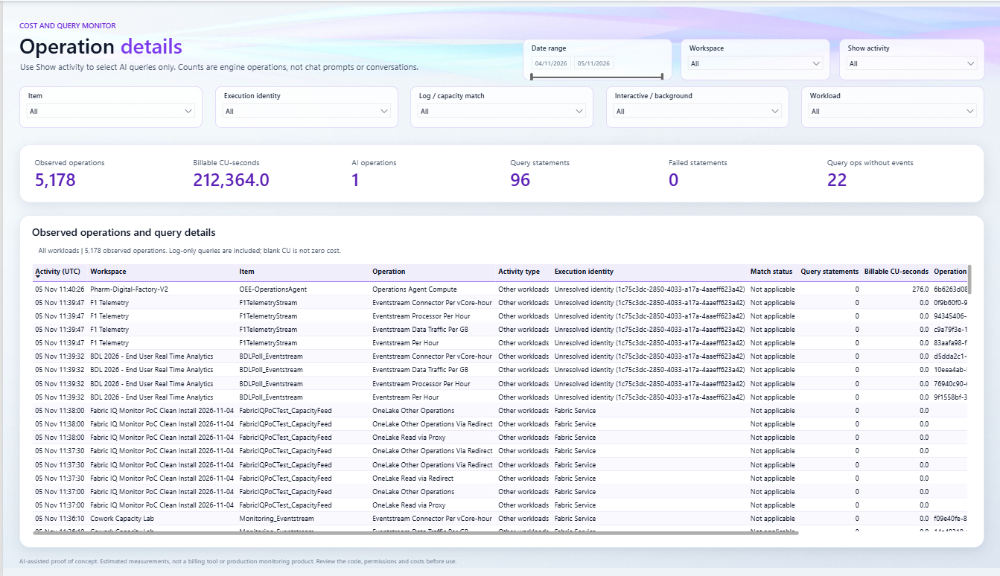
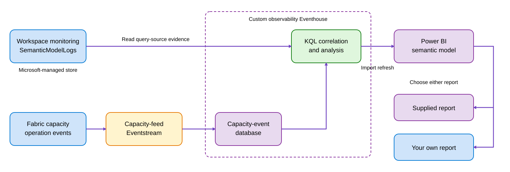
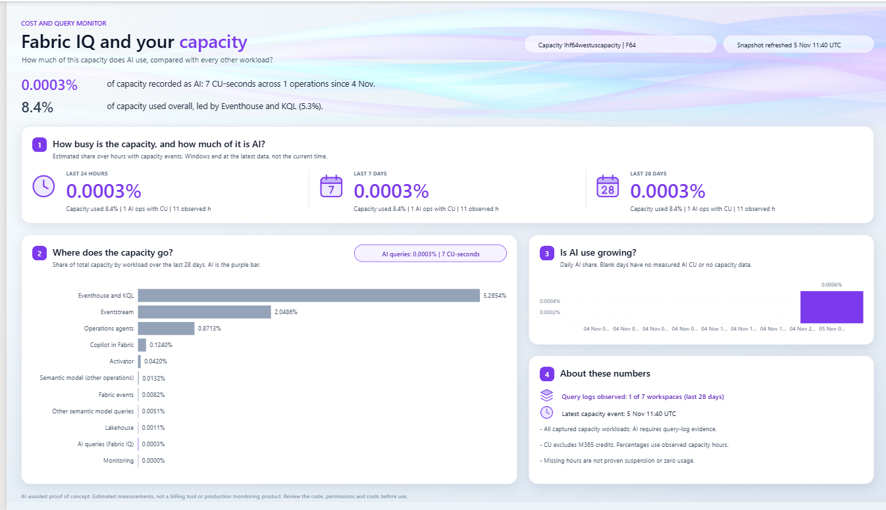
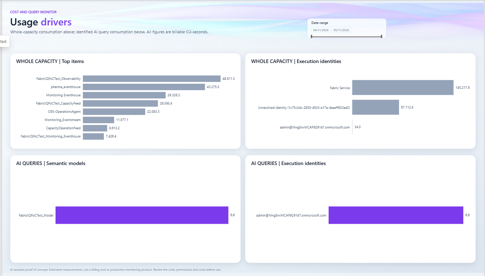
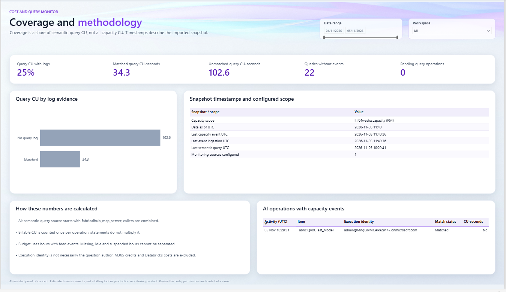
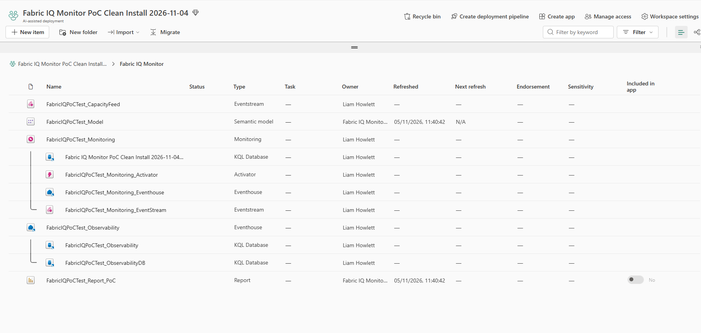

Fabric IQ Capacity Monitor
==========================

Discover how Fabric IQ identifies its Power BI queries in workspace monitoring
logs, then use that evidence to analyse their Fabric capacity consumption.

The useful part is the method. You don't need to deploy this solution to use
it. Take the queries into your existing monitoring setup, build your own
analysis, or connect your own report to the supplied semantic model.

The discovery and why it matters?
-------------------------------------------

I wanted to understand the Fabric compute associated with Fabric IQ querying
a Power BI semantic model. First I needed a way to distinguish those queries
from other model activity.

The useful discovery was this value in the query's source metadata:

.. code-block:: text

   fabricaihub_mcp_server_AskPowerBI_Sydney

It appeared in ``SemanticModelLogs``, inside
``ApplicationContext.Sources[].Operation``:

.. code-block:: json

   {
     "Sources": [
       {
         "Operation": "fabricaihub_mcp_server_AskPowerBI_Sydney"
       }
     ]
   }

That gives us something to look for. The queries below match the
``fabricaihub_mcp_server`` prefix, case-insensitively, rather than relying on
the whole observed value. It is evidence of this query route, not a universal
identifier for every AI feature.

Once you can find those queries, you can compare their activity with other
semantic-model queries and match their operations to capacity-consumption
events. The report in this repository is one way of presenting that analysis.

.. note::

   I used generative AI to help create the scripts, KQL, semantic
   model and report. This is an experimental example, so review the
   implementation before using it in your own environment.

Discover the identifier in your own environment
-----------------------------------------------

Enable `workspace monitoring
<https://learn.microsoft.com/en-us/fabric/fundamentals/workspace-monitoring-overview>`_
in the workspace containing the semantic model you want to observe. Monitoring
creates a managed telemetry store. It has no backfill, and
``SemanticModelLogs`` may not appear until suitable activity has occurred.

Ask a question through Fabric IQ that queries that model, then run this in the
workspace's monitoring KQL database:

.. code-block:: kusto

   SemanticModelLogs
   | where Timestamp > ago(7d)
   | where OperationName == "QueryEnd"
   | extend Context = parse_json(tostring(ApplicationContext))
   | mv-expand Source = Context.Sources
   | extend SourceOperation = tostring(Source.Operation)
   | where SourceOperation startswith "fabricaihub_mcp_server"
   | project Timestamp, WorkspaceName, ItemName, OperationId,
       SourceOperation, ApplicationContext
   | order by Timestamp desc

Inspect ``ApplicationContext`` in a matching row. The JSON above shows the
source field to look for; the complete context can contain other metadata.
One statement can contain several source entries, so this discovery query can
return more than one row for that statement.

No matches does not prove there was no AI activity. Check that you are reading
the right workspace, collection was enabled before the query, and the query
route actually supplies this metadata. Other routes may use different values,
and the observed identifier can change.

Compare it with other semantic-model activity
----------------------------------------------

This query counts each ``QueryEnd`` row once, even when it contains multiple
source entries:

.. code-block:: kusto

   SemanticModelLogs
   | where Timestamp > ago(7d)
   | where OperationName == "QueryEnd"
   | extend Context = parse_json(tostring(ApplicationContext))
   | extend Sources = iff(
       coalesce(array_length(Context.Sources), 0) > 0,
       Context.Sources, dynamic([{}]))
   | mv-apply Source = Sources on (
       summarize AiHits = countif(
           tostring(Source.Operation) startswith "fabricaihub_mcp_server")
     )
   | extend QueryRoute = iff(AiHits > 0,
       "Identified Fabric IQ", "Not identified as Fabric IQ")
   | summarize QueryStatements = count()
       by Day = bin(Timestamp, 1d), QueryRoute
   | order by Day asc, QueryRoute asc

This compares logged query statements, not prompts, conversations or CU.
The second category includes queries with missing source metadata. It mustn't
be treated as proof that all those queries were human-generated.

From query activity to capacity consumption
--------------------------------------------

Query logs tell us which route was used. To measure recorded Fabric compute,
the reference implementation also collects ``FabricCapacityOperationEvents``
through an Eventstream.

It correlates the two feeds using ``CapacityId``, ``WorkspaceId``, ``ItemId``
and ``OperationId``. Capacity events are deduplicated and summed per operation
before joining the query evidence, so several statements don't multiply an
operation's consumption. ``capacityUnitMs / 1000`` gives CU-seconds, with
billable and non-billable consumption kept separate.

The reusable implementation is in
`observability.template.kql <src/kql/observability.template.kql>`_.
``ObservabilityStatements()`` identifies the query source.
``ObservabilityCharges()`` prepares the capacity events.
``ObservabilityRequests()`` brings them together and retains unmatched rows.
The file is a deployment template; its placeholders need configuration before
you can run its function definitions yourself.

*Operation details from the clean-install demo, with all workloads selected.
The view includes one identified AI operation and queries without consumption
events. A blank CU value means unknown, not zero.*

Identified AI consumption is a lower bound within the observed scope.
Capacity events cover the selected capacity, but query evidence covers only
the configured workspaces. This doesn't measure M365 or Copilot credits,
Databricks charges, or all compute involved in answering an AI question.

Use as much or as little as you need
-------------------------------------

* Use the identifier and discovery queries in your existing monitoring setup.
* Reuse the correlation KQL with your own capacity-event feed and analysis.
* Use the supplied semantic model and build your own Power BI report.
* Deploy the complete reference example, including its four-page report.

There are no separate installer switches to omit the model or report. The
bundled installer deploys the complete example; the source files are available
if you want to reuse only part of it.

Reference architecture
-----------------------

port.

The workspace monitoring logs stay in their Microsoft-managed store. The
custom observability Eventhouse holds the capacity-event database and KQL
functions, which read the configured monitoring sources alongside those events.
There is no second ingestion pipeline copying query logs into the custom store.

The semantic model imports the results on refresh. The supplied report and
your own report are alternatives over that model.
`Mermaid diagram source <docs/images/architecture.mmd>`_ is included.

What does the supplied report show?
------------------------------------

The report screenshots show the clean-install demo refreshed at 11:40 UTC on
5 November 2026. Its matched AI operation consumed 6.576 CU-seconds, displayed
as 6.6 in the drivers and coverage pages and rounded to 7 in the overview.
These are demo values, not expected usage levels or a benchmark for your capacity.

Fabric IQ and your capacity
~~~~~~~~~~~~~~~~~~~~~~~~~~~

Start with identified AI consumption alongside the other workloads. The
overview includes rolling windows and the scope of the available evidence.

Usage drivers
~~~~~~~~~~~~~

Compare the items using the capacity with the semantic models involved in
identified AI activity. Execution identities are reported principals, not
necessarily the people who asked the questions.

Operation details
~~~~~~~~~~~~~~~~~

Filter by workspace, model, execution identity or match status. Select
``Show activity`` then ``AI queries`` to filter to identified AI activity.
The screenshot earlier shows all workloads. Log-only queries remain visible
even when no consumption event can be matched.

Coverage and methodology
~~~~~~~~~~~~~~~~~~~~~~~~

Check matched and unmatched semantic-query CU alongside the snapshot and
source timestamps. This helps distinguish missing evidence from low usage.

The report uses an Import snapshot, not a live meter. ``Data as of`` is not
the latest event time. The 24-hour, 7-day and 28-day windows end at the latest
feed-data hour, not the current clock time. Capacity-share percentages use
hours with observed feed events; missing, idle and suspended hours cannot be
distinguished. They are not smoothed capacity utilisation.

Deploy the reference example
----------------------------

You deploy into your own Fabric tenant on an existing, running capacity.
Start in an isolated test workspace. The demo tenant isn't a prerequisite,
and no capacity is created or resumed by the installer.

You need PowerShell 7.4 or later and Azure CLI. You also need capacity
administrator access to subscribe to capacity events, permission to create
and assign a workspace, and access to the relevant Fabric preview features.
Power BI Desktop and Python aren't needed for installation.

Read `the installation guide <docs/installation.rst>`_ for the full
prerequisites, permission requirements and configuration options.
Download the repository ZIP from GitHub, or clone it if you have Git installed:

.. code-block:: powershell

   git clone https://github.com/liamhowlett/fabric-iq-capacity-monitor.git
   Set-Location .\fabric-iq-capacity-monitor
   az login --tenant <tenantId>
   Copy-Item .\config.example.json .\config.local.json

Edit ``config.local.json`` with your tenant and capacity IDs. Choose the
workspace name and item prefix, then review the plan before deploying:

.. code-block:: powershell

   .\Deploy.ps1 -Config .\config.local.json -WhatIf
   .\Deploy.ps1 -Config .\config.local.json
   .\Test.ps1 -Config .\config.local.json -GenerateActivity

The installer creates the workspace identity and required items, binds the
model to its cloud connection, and requests one model refresh. It doesn't
enable scheduled refresh, tenant settings, Operations Agent or Activator alerts.
The activity generated by ``Test.ps1`` is not a genuine Fabric IQ interaction.

Monitor the workspaces containing your real models
~~~~~~~~~~~~~~~~~~~~~~~~~~~~~~~~~~~~~~~~~~~~~~~~~~

The default configuration enables monitoring in the newly created target
workspace only. It doesn't automatically discover or monitor every business
workspace on the capacity.

For models elsewhere, enable monitoring in those source workspaces and list
their KQL databases in ``monitoring.sources``. With ``monitoring.mode`` set to
``Existing``, the installer reuses explicitly configured monitoring sources
rather than creating new monitoring in the target workspace:

.. code-block:: json

   "monitoring": {
     "mode": "Existing",
     "sources": [
       {
         "endpoint": "https://<source-query-endpoint>",
         "database": "<monitoring-database>"
       }
     ]
   }

Both the deployment operator and the target workspace identity need read/query
access to those databases. The installer doesn't grant permissions in the
source workspaces. Read the guide before configuring cross-workspace sources;
that topology hasn't completed the same end-to-end demo exercise.

Keep the workspace tidy
~~~~~~~~~~~~~~~~~~~~~~~

The example configuration creates a ``Fabric IQ Monitor`` folder containing
the solution's items and Fabric-generated children:

.. code-block:: text

   Fabric workspace
   +-- Fabric IQ Monitor
       +-- Monitoring and its generated supporting items
       +-- Capacity-feed Eventstream
       +-- Observability Eventhouse and databases
       +-- Power BI semantic model
       +-- Power BI report

The Monitoring item controls Fabric's built-in workspace diagnostics. Fabric
creates its managed storage and supporting items. The capacity-feed
Eventstream and writable observability Eventhouse are separate custom items.

*The clean-install demo after folder organisation. Fabric-generated monitoring
items are grouped alongside the custom capacity feed, model and report.*

To reuse a folder, clear ``folderName`` and supply ``folderId`` explicitly.
Folders organise items; they don't change permissions or isolate compute.
Workspace identities and cloud connections aren't folder items.
Folder creation uses a preview API.

To organise an existing completed installation without redeploying definitions
or refreshing the model, keep its local configuration and saved state, select
a folder, then run:

.. code-block:: powershell

   .\Deploy.ps1 -Config .\config.local.json -FolderOnly -WhatIf
   .\Deploy.ps1 -Config .\config.local.json -FolderOnly

Only recorded owned parents move, with their generated children. External
monitoring sources stay where they are, and unknown items block parent moves.
See the installation guide for the ownership safeguards.

Before using this
----------------------------------

.. warning::

   This is an experimental, community-supported proof of concept. It isn't
   an official Microsoft offering, a production-ready monitoring product or
   a billing tool. No accuracy or production-support commitment is made.
   Review the code and permissions, assess the cost.

Monitoring itself consumes capacity. Telemetry can contain identities and
query text, so review access and retention before collecting it. Don't commit
live exports, deployment state or local configuration.

A clean demo deployment and selected lifecycle exercises are recorded in
`testing notes <docs/testing.rst>`_. A genuine Fabric IQ operation was identified,
matched to capacity consumption and shown in the refreshed model and report.
Broader coverage, fresh folder-based deployment and recovery/removal exercises
remain incomplete. No security or compliance audit has been performed.

Keep the same local configuration and ``.state`` directory when resuming an
installation. Don't delete the state to recover from a failed step, and don't
overwrite an existing local configuration with the example.

Further reading
---------------

* `Installation <docs/installation.rst>`_: prerequisites and configuration.
* `Operations <docs/operations.rst>`_: refresh, recovery and safe removal.
* `Limitations <docs/limitations.rst>`_: coverage, accounting and data protection.
* `Disclaimer <DISCLAIMER.rst>`_: suitability and AI-assisted development.

The code, bundled artwork and documentation are available under the
`MIT License <LICENSE>`_. Microsoft cloud services and runtime prerequisites
retain their own terms.
